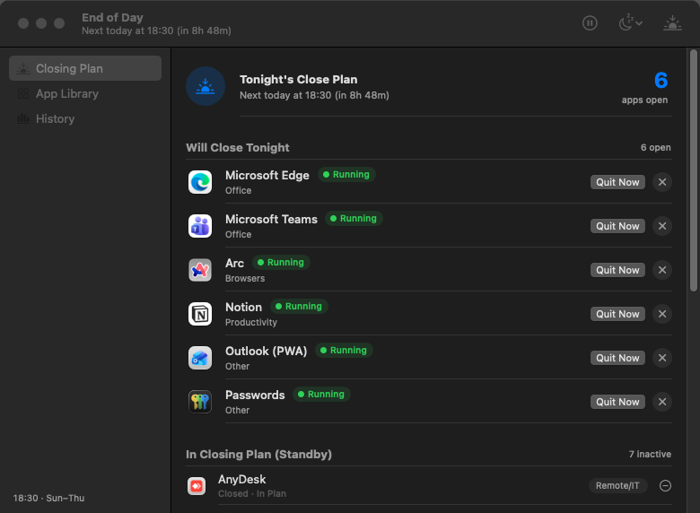
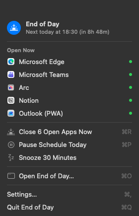
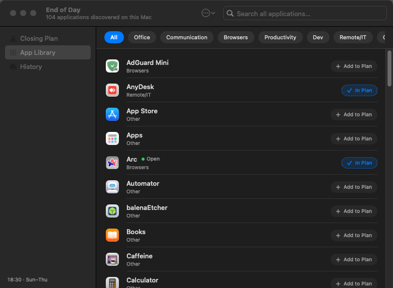
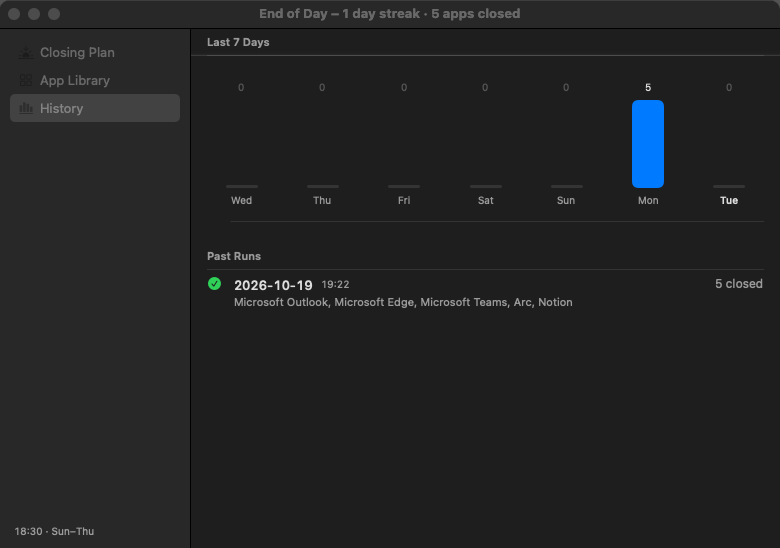
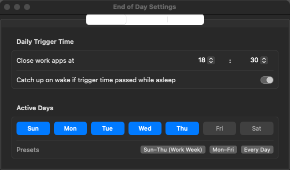

# EndOfDay 🌅

A native macOS menu bar app and full companion window that automatically and gracefully closes configured work apps at the end of your workday. Built the Summon way with Swift 6, SwiftUI, and live Summon theme synchronization.



---

## Highlights

- **Dynamic App Discovery (100+ Applications):** Automatically enumerates applications across `/Applications`, `/System/Applications`, and `~/Applications`, with intelligent category inference.
- **Dedicated Closing Plan (⌘1):** Clear visibility into what is running and scheduled to quit tonight, standby configured apps, open app suggestions, and today's closed run feed.
- **App Library (⌘2):** Tactile, modern app explorer with category filter pills, count badges, and one-tap `+ Add to Plan` / `✓ In Plan` pills (no tedious checkboxes).
- **Control Center Menu Bar Extra:** Compact menu bar module with live countdown, quick snooze/pause, and one-click app termination.
- **Zero Third-Party Dependencies:** Pure Swift 6 + SwiftUI + AppKit bridges, tested with `swift-testing`.

---

## Screen Captures

| Menu Bar Extra (`PanelView`) | App Library (`AppLibraryView`) |
|:---:|:---:|
|  |  |

| Closing Plan (`ClosingPlanView`) | Activity & History (`StatsDetailView`) |
|:---:|:---:|
|  |  |

<p align="center">
  <b>Settings Window (⌘,)</b><br/>
  
</p>

---

## Features

### 1. Closing Plan (`ClosingPlanView` — ⌘1)
- **Will Close Tonight (Running Now):** Prominent interactive cards showing which apps will quit at closing time, complete with live green pulsing indicators, category tags, priority tiers, and instant **Quit Now** / **Remove** controls.
- **In Closing Plan (Standby):** Configured apps that are currently closed, ready to be terminated if launched during the workday.
- **Other Open Apps (Quick Add Suggestions):** Detects running user applications that are not yet in your plan and presents a 1-tap `+ Add to Plan` button so you never need to search.
- **Closed Today Feed:** Chronological report card of today's terminated applications with timestamps and count badges.

### 2. App Library (`AppLibraryView` — ⌘2)
- **Deep System Scanning:** Automatically discovers all installed `.app` bundles on your Mac while filtering internal system daemons.
- **Smart Category Inference:** Automatically groups discovered apps into `Office`, `Communication`, `Browsers`, `Productivity`, `Dev`, `Design`, `Remote/IT`, and `Other`.
- **Interactive Tactile Pills:** Replaced legacy checkboxes with modern state buttons (`+ Add to Plan` / `✓ In Plan`) with instant feedback on hover and tap.
- **Filter Pills with Counts:** Horizontally scrollable category pills with dynamic item count badges (`Dev (24)`, `Browsers (5)`, etc.).
- **Live Search:** Instant filtering across app names, categories, and bundle identifiers.

### 3. Menu Bar Extra (`PanelView`)
- Control Center–style status card displaying next closing time, active days, running work apps count, streak, monthly total, and all-time statistics.
- 30-second inline countdown banner with live progress bar, `Close Now`, `Snooze 30m`, and `Cancel`.
- Individual running app rows with native macOS Retina icons and one-click `Quit`.
- Fast shortcuts: `Run End of Day Now` (`⌘R`), `Pause/Resume Today` (`⌘P`), and `Snooze` (`15m` / `30m` / `1h`).

### 4. Settings Window (⌘,)
- **Schedule:** Customizable closing time (`Hour:Minute`), active workday toggles + presets (`Sun–Thu Work Week`, `Mon–Fri`, `Every Day`), and missed wake catch-up.
- **Shutdown:** Soft mode (`30s Countdown` with notifications) vs Hard mode (`Immediate + Force Quit` fallback) with staggered delay (`0–10s`).
- **General:** `Open at Login` (`SMAppService`), menu bar time label toggle, and live theme synchronization from `~/.config/summon`.

---

## Keyboard Shortcuts

| Shortcut | Action |
|:---|:---|
| `⌘1` | Open Closing Plan view |
| `⌘2` | Open App Library explorer |
| `⌘3` | Open History & Stats view |
| `⌘R` | Run / Close work apps now |
| `⌘P` | Pause / Resume schedule for today |
| `⌘O` | Open companion window |
| `⌘,` | Open Settings window |
| `⌘Q` | Quit End of Day |

---

## Project Structure

```
end-of-day/
├── Sources/
│   ├── EndOfDay/          # @main entry point: MenuBarExtra, Window, and Settings scenes
│   ├── EndOfDayUI/        # PanelView, ClosingPlanView, AppLibraryView, StatsDetailView, SettingsView
│   └── EndOfDayCore/      # AppCatalog, EndOfDayConfig, ScheduleEngine, AnalyticsStore, TerminationEngine
├── Tests/
│   └── EndOfDayCoreTests/ # swift-testing suite (discovery, schedule, config migration, priority engine)
├── docs/
│   └── screenshots/       # High-resolution screenshots generated via --snapshot
├── scripts/
│   ├── check.sh           # Verification gate: build, test suite, plist lint, and bundle check
│   └── bundle.sh          # Production release packager
└── Package.swift          # SwiftPM manifest (macOS 15+, Swift 6 strict concurrency)
```

---

## Building and Verification

Run the full automated check suite (compiles debug, executes all unit tests, verifies `Info.plist`, and builds `build/EndOfDay.app`):

```bash
./scripts/check.sh
```

To regenerate the documentation screenshots:

```bash
./build/EndOfDay.app/Contents/MacOS/EndOfDay --snapshot docs/screenshots
```

To run the application:

```bash
open build/EndOfDay.app
```

---

## License

MIT License. Designed and built with ❤️ as a native Summon companion.
